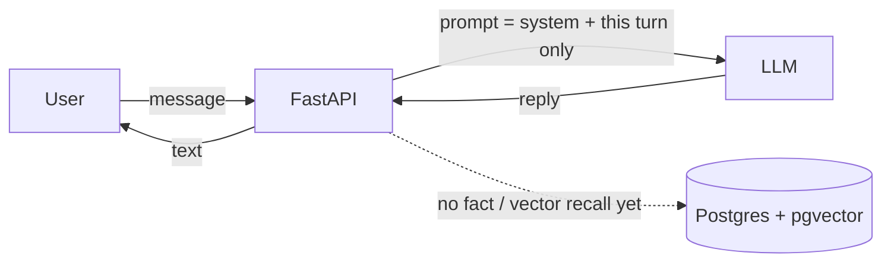
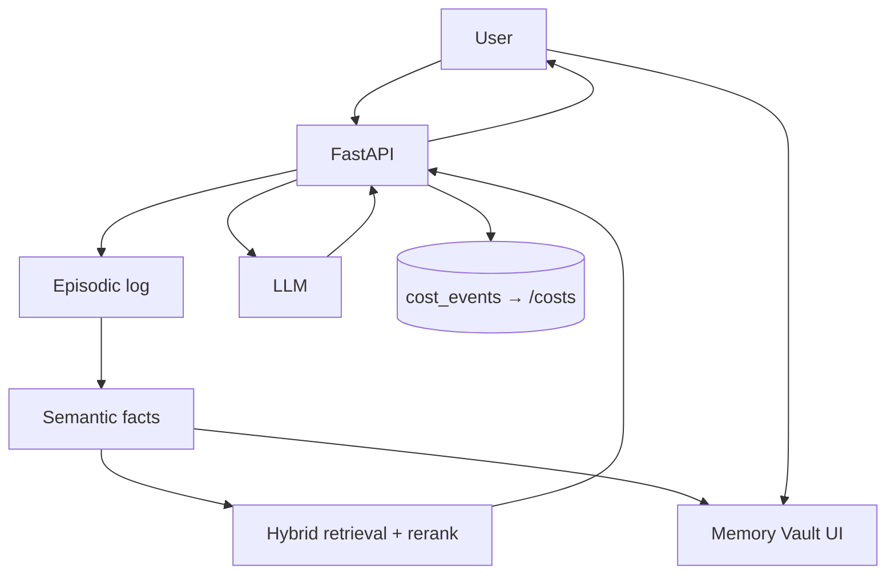

# Episode 1 — "Memory Is the Product"
*Article-first. Canonical long-form → Hashnode → dev.to → X → LinkedIn → Reddit (one sub) → German (`needs-justin-qa-de`). Publish target: Week 1, after Sprint 1 skeleton runs — and only after Justin's explicit yes for this piece.*

**Status:** Outline revised after PLAN-v2 approval (2026-10-27, America/Denver). Aligned with article-first syndication; bot-owned YouTube/Shorts tasks removed.

**Series:** Building a Companion That Remembers  
**Product:** Fresh SFW AI companion (never Desire)  
**Stack to write ABOUT:** Python 3.12 / FastAPI / PostgreSQL+pgvector / local embeddings (`all-MiniLM-L6-v2`) / Kokoro TTS / Cloud Run  
**Canonical domain:** TBD  
**Public GitHub repo:** TBD  
**Name shortlist:** TBD (after RDAP/handle checks; do not publish vote list until checks pass)

---

## Hook (first ~2 lines of article / AEO snippet lead-in)

Chat with v0. Tell it your name, your goal, something personal.  
Refresh the page. It introduces itself like you've never met.

> "That's not a companion. That's a chatbot with a face. This series is me fixing that — in public, with the costs on the table."

**Mohamed failure → our fix (Ep 1 beat):** Refresh → total amnesia / "chatbot with a face" → intentional v0 that forgets on purpose, then layered memory + Memory Vault in Ep 2. Credit him; steal the lesson, not the prose.

**Primary question (H1 / AEO):** Why do AI companions forget you on refresh?  
**Direct answer (40–80 words at top of article):** Because the model only sees the current context window. Without a durable memory layer outside the prompt, a page refresh (or a new session) starts from zero. Pasting the whole history into every call is slow and expensive. Episode 1 ships an intentional forgetful v0 so the amnesia is visible — then the rest of the series builds memory you can see, edit, and delete.

---

## Structure (canonical article)

1. **AEO answer + hook** — refresh-forgets demo described; "chatbot with a face" line.
2. **The problem** — LLMs forget by design (context window). Why pasting whole history fails (latency, cost, still no durable facts/forgetting/recency).
3. **Credit Mohamed / what we're stealing vs fixing** — open credit + links to all five Hashnode parts + Reddit write-up. Steal: pgvector-in-Postgres, local embeddings, relationship state as a first-class idea. Fix by design (Ep 1 opens the amnesia beat): opaque memory → Vault; costs at the end → `/costs` from day 1; paid TTS economics → Kokoro; 3D sink → 2D first; naive RAG → layered memory (Ep 2–3).
4. **Three locked hooks** (do not dilute):
   - Memory Vault UI (edit / pin / delete) — mockup or prose preview; ships Ep 2
   - Companion with a job — default accountability / follow-through
   - Live `/costs` from day 1 — empty-state teaser this episode; real numbers when instrumented
5. **Sprint 1 build story** — skeleton only; intentional forget-on-refresh. Use placeholders where repo/logs don't exist yet. No invented demo results.
6. **7-episode roadmap** — table from PLAN-v2 (demo moments + publish notes).
7. **Cost box** — only real / unmeasured language. If `logs/` empty / Sprint 1 not started: say so. Budget caps: ≤$25/mo hosting, ≤$20/mo LLM, $0 paid TTS in v1.
8. **SFW / not-a-therapist boundary** — brief call-out (friendship/accountability register; adults-oriented; crisis resources in system prompt from v1; user owns memory).
9. **The asks (comments fuel the series)**:
   - Name vote: shortlist TBD after RDAP/handle checks (process described; list not invented)
   - Job vote: accountability partner (recommended) / conversational friend / learning partner
   - One question: "What's the first thing a companion should never forget?"
10. **Diagrams** — see below; include as mermaid or prose descriptions in the article.
11. **Syndication footer** — canonical URL TBD; list planned channels; German flagged `needs-justin-qa-de`.

---

## Diagrams to include in the article

### Diagram A — v0 (this episode): intentional amnesia
**Description:** Browser → FastAPI chat endpoint → LLM router (e.g. Groq) → reply. No durable store of facts or embeddings on the request path that survives refresh. Optional: Postgres/pgvector present in the skeleton but unused for memory retrieval yet. Label clearly: "v0 is supposed to forget."

**Mermaid sketch (article may paste):**

### Diagram B — layered memory preview (Ep 2–3 destination)
**Description:** Same chat path, plus: episodic log (raw, not injected wholesale) → semantic fact extraction → hybrid retrieval (vector + keyword + recency + importance, pinned always) → Memory Vault UI (read / edit / pin / delete) → `cost_events` feeding public `/costs`. Label: "preview — not built in Ep 1."

**Mermaid sketch:**

---

## Cost box rules (for this episode)

- Source of truth: `/workspace/companion-series/logs/cost-log.md` (and later public repo `/docs/cost-log.md`).
- As of outline revision: **`logs/` does not exist yet — Sprint 1 not started / unmeasured.**
- Article must say that honestly. Do **not** invent $0-as-if-measured unless Justin logged $0 after local work; prefer "Sprint 1 not started — $0 measured because nothing has been billed; caps are…"
- Always state caps: hosting ≤$25/mo until Ep 6; LLM ≤$20/mo during build; no paid TTS in v1.

---

## Syndication checklist (copy into publish ticket; check only after Justin's yes per channel)

- [ ] Canonical article on Justin's domain (canonical URL set) — **domain TBD**
- [ ] Hashnode syndicate with canonical back-link
- [ ] dev.to syndicate with canonical back-link
- [ ] X thread (summary + link; no cold DMs)
- [ ] LinkedIn builder post (summary + link)
- [ ] Reddit — one sub only; Ep 1 default candidate: r/Development; rewrite opener for the sub; lead with the technical problem; link repo + article
- [ ] German article — draft → flag `needs-justin-qa-de` → wait for Justin yes; typical lag 2–3 days after English
- [ ] Update public GitHub README with episode link — **repo TBD**
- [ ] Update series index / hub with "shipped" mark when live

**Out of scope for this bot:** YouTube long-form, Shorts, voiceovers. Justin may film personally outside this checklist; that still needs per-piece approval and is not a bot task.

---

## Reddit notes (Ep 1)

- One sub only (candidate: r/Development, where Mohamed posted).
- Rewrite opener for the sub; lead with the technical problem (context window / refresh amnesia), not series promo.
- Link public repo + canonical article when both exist.
- Never multi-sub spam the same day.

---

## Placeholders Justin must fill before publish

| Placeholder | Status |
|---|---|
| Canonical domain / URL | TBD |
| Public GitHub repo URL | TBD |
| Name shortlist (10–12 after RDAP/handle checks) | TBD |
| Sprint 1 decision + cost log rows | Not started (`logs/` absent) |
| Job emphasis lock (accountability recommended) | Pending Justin |

---

## Approval gate

PLAN-v2 is locked. This outline and the Episode 1 draft are **not** a publish license. Wait for Justin's explicit yes for this article piece only (e.g. "yes, publish Ep 1 canonical"). Then re-gate each syndicate channel.
