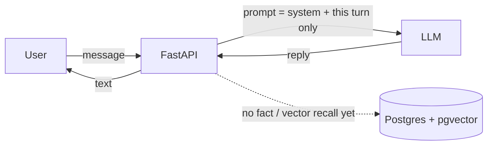
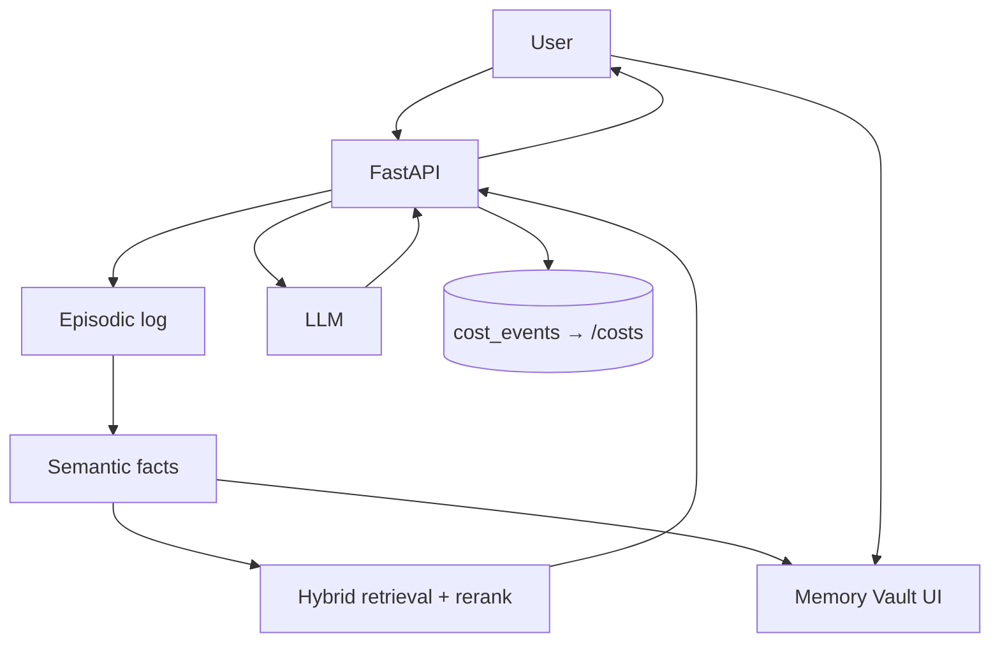

# Why do AI companions forget you on refresh?

**Series:** Building a Companion That Remembers — Episode 1  
**Working title:** Memory Is the Product  
**Status:** PUBLISHED 2026-10-27 — canonical live. Per-channel syndicate still needs its own yes.  
**Canonical URL:** https://justinzwick.com/why-do-ai-companions-forget-you-on-refresh/  
**Public repo:** https://github.com/justzwick/companion-that-remembers  
**Date drafted:** 2026-10-27 (America/Denver)

---

**Direct answer:** An AI companion forgets you on refresh because the language model only sees the current context window. Unless you persist facts and retrieval *outside* the prompt, a new page load (or a new session) starts from zero. Pasting the entire chat history into every call is slow, expensive, and still doesn't give you durable facts, forgetting, or recency. This episode ships an intentional forgetful v0 so the amnesia is visible — then the rest of the series builds memory you can see, edit, and delete.

---

## The hook: refresh, and you're a stranger again

Chat with v0. Tell it your name. Tell it the goal you're chasing this month. Mention one personal detail that should matter next time.

Refresh the page.

It introduces itself like you've never met.

That's not a companion. That's a chatbot with a face.

This series is me fixing that — in public, with the costs on the table.

I'm Justin. Over the next seven weekly episodes I'm building a fresh, SFW AI companion from scratch: Python, FastAPI, Postgres with pgvector, local embeddings, self-hosted voice, and a public cost dashboard from day one. The product does not exist yet as a polished app. Episode 1 is the honest starting line: a skeleton that is *supposed* to forget, so we can measure every improvement against a failure everyone can see.

---

## The problem: LLMs forget by design

Large language models do not "remember" you. They condition on whatever text you put in the prompt, up to a hard context-window limit. When the session ends, or the window fills, that conditioning is gone unless *you* stored something elsewhere and put it back in.

The naive fix is pasting the whole history into every request. That fails in three ways:

1. **Latency** — longer prompts get slower and flakier under load.
2. **Cost** — you pay for every repeated token, every turn.
3. **Quality** — a dump of raw turns is not a fact store. You get duplicates, no structured forgetting, weak recency, and "similar but wrong" retrieval when you eventually bolt on embeddings without an eval harness.

So the real product is not the chat bubble. The product is **memory you can trust** — stored, retrieved, inspected, corrected, and deleted by the user.

---

## Credit where it's due: Mohamed Abu Saif / Lumine

This series exists because Mohamed Abu Saif documented building an AI companion in public — architecture, mistakes, and the economics that stopped him. I'm not rewriting his articles. I'm learning from his failure points and designing around them.

Read his work (study the structure; I'm not copying prose):

- [Part 1 — from simple chatbot to a system that can remember](https://mohamedabusaif.hashnode.dev/building-my-ai-companion-from-a-simple-chatbot-to-a-system-that-can-remember-part-1)
- [Part 2 — database schema breakdown](https://mohamedabusaif.hashnode.dev/building-my-ai-companion-from-a-simple-chatbot-to-a-system-that-can-remember-part-2)
- [Part 3 — RAG and vector memory](https://mohamedabusaif.hashnode.dev/building-my-ai-companion-from-a-simple-chatbot-to-a-system-that-can-remember-part-3)
- [Part 4 — features breakdown](https://mohamedabusaif.hashnode.dev/building-my-ai-companion-from-a-simple-chatbot-to-a-system-that-can-remember-part-4)
- [Part 5 — why he stopped (TTS economics and more)](https://mohamedabusaif.hashnode.dev/building-my-ai-companion-from-a-simple-chatbot-to-a-system-that-can-remember-part-5)
- [Reddit write-up on r/Development](https://www.reddit.com/r/Development/comments/1uhrwlp/i_built_an_ai_companion_from_scratch_memory_rag/)
- Blog hub: [mohamedabusaif.hashnode.dev](https://mohamedabusaif.hashnode.dev/)

### What we're stealing (lessons, not copy)

- **Postgres + pgvector as one brain** — vectors live next to relational data; no separate exotic memory DB for v1.
- **Local embeddings** — keep the embedding path cheap and private (we'll use `sentence-transformers` / `all-MiniLM-L6-v2` in Python).
- **Relationship state as a first-class idea** — something durable about "where we are" beyond the last N messages (we'll keep that SFW: trust, threads, follow-ups — not romance meters).

### What we're fixing by design (his failure → our constraint)

| Failure point (from his journey) | Our design fix | When we prove it |
|---|---|---|
| Refresh → total amnesia; "chatbot with a face" | Intentional v0 that forgets, then layered memory + Vault | **Ep 1 → Ep 2** |
| Naive RAG: embed every message, top-k cosine, no facts/forgetting/recency | Episodic log + semantic facts + hybrid retrieval + decay + eval harness | Ep 2–3 |
| Memory is opaque | Memory Vault UI (edit / pin / delete) | Ep 2 |
| Weeks lost to 3D | 2D animated portrait first; 3D only if audience votes later | Ep 4 |
| Premium TTS economics killed the product | Kokoro self-hosted TTS from day one; no paid TTS in v1; `/costs` live | Ep 4, Ep 6 |
| Costs discovered at the end | `cost_events` + public `/costs` from Episode 1 empty state | Ep 1 teaser → Ep 6 |
| Free-running proactive messaging | Scheduler + caps + quiet hours + "why it fired" in Vault | Ep 5 |
| Single-vendor LLM fragility | Router: cheap/fast path + quality path for evals + offline option | Ep 1–6 cost boxes |
| No public artifact as distribution | Public GitHub from commit #1 | Ep 1 |

Episode 1 owns the first row on purpose. We do not ship "memory" this week. We ship the amnesia, labeled, so next week's Vault has a before-picture.

---

## Three hooks this series will not dilute

### 1. Memory you can see — the Memory Vault

Every stored memory should be readable, editable, pinnable, and deletable in a UI. That is the trust feature and the demo moment: *watch — it learned this, and I can delete it.* Vault ships in Episode 2. This episode only previews the destination.

### 2. Companion with a job — accountability / follow-through

Personality is configurable. Purpose is not "be charming forever." Default job: **accountability partner** — goals, habits, people, things you said you'd do. Episode 1 opens a job vote (see asks below). Recommended default stays accountability unless the audience and I lock something else.

### 3. Costs published live from day 1

Mohamed discovered TTS economics late and stopped. We design to a budget at the start and report every episode. Public `/costs` will show cost per conversation, per voice minute, per active user — when instrumentation exists. This episode shows the empty-state promise and the caps. No invented charts.

---

## Sprint 1 build story: skeleton + intentional forget

**Honest status:** As of this draft (2026-10-27, America/Denver), Sprint 1 has not been logged under `logs/`. There is no public GitHub URL yet, and no measured cost rows. What follows is the *plan for the Sprint 1 artifact*, not a claim that the demo already shipped.

### What Sprint 1 should produce

- Public repo from commit #1: https://github.com/justzwick/companion-that-remembers.
- Python 3.12 + FastAPI app with a minimal chat endpoint.
- Postgres + pgvector in the skeleton (present for the path ahead; not yet powering recall).
- A chat UI that holds conversation only in the live session (or equivalent) so **refresh clears identity**.
- An empty `/costs` surface (or stub) that reads from a `cost_events` table shape — even if the table is empty.
- Decision-log and cost-log templates copied into `/docs/` once the repo exists.

### What Sprint 1 deliberately does *not* do

- No fact extraction.
- No vector retrieval on the reply path.
- No Memory Vault UI.
- No voice.
- No 3D.
- No invented recall scores.

### The demo moment (when Sprint 1 runs)

1. Tell v0 your name and one goal.  
2. Refresh.  
3. Watch it greet you as a stranger.  
4. Caption it: **v0 is supposed to forget.**

When that clip or GIF exists, this article gets updated with the real artifact link — not a fabricated screenshot description.

### Stack we are writing about (Justin builds; this series does not ship product code from the drafting bot)

| Layer | Pick |
|---|---|
| Backend | Python 3.12 + FastAPI |
| DB | PostgreSQL + pgvector |
| ORM / migrations | SQLAlchemy 2 + Alembic |
| Embeddings | `all-MiniLM-L6-v2`, local |
| LLM | Router: cheap/fast (e.g. Groq) + quality for evals + Ollama offline |
| TTS (later) | Kokoro self-hosted; no paid TTS in v1 |
| STT (later) | faster-whisper, local |
| Avatar v1 (later) | 2D animated portrait |
| Deploy (later) | Google Cloud Run + managed Postgres |
| Repo | Public GitHub from commit #1 |

---

## Diagrams

### A — v0 this episode: intentional amnesia

Browser sends a message to FastAPI. FastAPI builds a prompt from system instructions plus **this turn only** (or session-only history that dies on refresh), calls the LLM router, returns text. Postgres/pgvector may exist in the project but is not used for recall yet. Label on the diagram: **v0 is supposed to forget.**

### B — layered memory preview (Episodes 2–3 destination)

Same chat path, plus: episodic log (raw conversations, never injected wholesale) → semantic fact extraction → hybrid retrieval (vector + keyword + recency + importance; pinned always available) → Memory Vault UI (read / edit / pin / delete) → `cost_events` feeding public `/costs`. Label: **preview — not built in Episode 1.**

---

## Roadmap: seven episodes

Slips are content. If a week slips, we document the block and the new date — we do not invent progress.

| Wk | Build sprint | Article | Demo moment | Publish note |
|---|---|---|---|---|
| 1 | Repo, FastAPI + Postgres/pgvector skeleton, chat that forgets on refresh + name shortlist | Ep 1: Memory is the product | Refresh-forgets-everything, live | Name vote opens; empty `/costs` mock |
| 2 | Layered memory: fact extraction, retrieval, Memory Vault UI v1 | Ep 2: Memory you can see | Remembers after restart; delete → forgets | First real Vault screenshots |
| 3 | Hybrid retrieval + reranking, decay, 50-fact eval harness | Ep 3: Beating naive RAG | Published **measured** recall score, before vs after | No invented metrics |
| 4 | Kokoro + faster-whisper, avatar states, response caching | Ep 4: Killing the voice bill | Blind A/B vs premium TTS clip + **measured** cost/min | No paid TTS |
| 5 | Relationship state + follow-ups + proactive scheduler | Ep 5: Check-ins with guardrails | Check-in that fires for a visible reason | Safety review gate |
| 6 | Cloud Run deploy, public demo, `/costs` live, export/delete | Ep 6: Shipping + what a user costs | Live `/costs` walkthrough | Real numbers only |
| 7 | Audience-voted feature + retro | Ep 7: What broke, what I'd rebuild | Failures reel (written) + roadmap vote | Scope dump + next season |

---

## Cost box (Episode 1)

**Measured spend to date:** Sprint 1 not started / unmeasured. Working cost log under `/workspace/companion-series/logs/` does not exist yet. There are no billed Cloud Run hours, no logged LLM tokens, and no TTS minutes to report. I will not invent a pretty $0 chart that pretends instrumentation already ran.

**When a real $0 row exists** (local-only week with nothing billed), it will be logged as $0 with method notes — not assumed.

**Budget caps (targets, set before code):**

- Hosting / dev all-in: **≤ $25/mo** until Episode 6 (Cloud Run scale-to-zero + small Postgres).
- LLM during build: **≤ $20/mo**; every call logged to `cost_events` when instrumentation exists.
- **No paid TTS in v1** (Kokoro self-hosted).

`/costs` in this episode is an empty-state teaser. Episode 6 is the live walkthrough with real numbers only.

---

## Boundaries (SFW, adults-oriented, not a therapist)

This companion is friendship / accountability register only. No romantic or sexual roleplay modes. It is adults-oriented and not marketed to minors.

It is **not a therapist**. From v1, the system prompt will carry a clear not-a-therapist boundary plus crisis-resource responses. User owns memory: export and full delete in the UI when those features ship (Ep 6).

If you are in crisis, contact local emergency services or a crisis line in your area — do not use this project as care.

---

## Asks: help steer Episode 2+

Comments (and later an X poll, if we run one) fuel the series. Three asks:

### 1. Name vote

Working series title is **Building a Companion That Remembers**. The character / product name is **not** pre-decided.

Process (locked):

1. Brainstorm 10–12 candidates.  
2. Pre-flight RDAP/WHOIS + handle checks (X, GitHub, etc.).  
3. Publish the shortlist **only after** checks — mark taken/risky clearly.  
4. Vote in comments (optional X poll).  
5. I pick the winner (vote informs; brand/legal can override plurality).  
6. **Only then** consider buying a domain or handle — and only I spend money. No purchases before the vote closes.

**Shortlist:** TBD after RDAP/handle checks. This draft intentionally does not invent names.

### 2. Job vote

What should the companion's *job* be by default?

- **Accountability / follow-through partner** (recommended default)
- Conversational friend
- Learning / study partner

Personality can still vary. The job sets the system prompt and the follow-up behavior.

### 3. One question

**What's the first thing a companion should never forget?**

Reply with one concrete fact type (a name, a hard constraint, a goal, a person, a boundary). Best answers become Vault pin candidates and eval-harness fodder in Episodes 2–3.

---

## Glossary (one term)

**Context window** — the maximum amount of text a model can condition on in a single call. It is not long-term memory. Anything you want remembered across sessions must live outside the window and be retrieved on purpose.

---

## Syndication note

**Canonical URL:** https://justinzwick.com/why-do-ai-companions-forget-you-on-refresh/ (Justin's own domain).  
Planned syndicate order after canonical publish and per-channel yes: Hashnode (canonical back-link) → dev.to (canonical back-link) → X thread → LinkedIn builder post → Reddit **one sub** (Ep 1 candidate: r/Development; native opener; lead with the technical problem) → German draft flagged `needs-justin-qa-de` (typical lag 2–3 days) → README / series hub update.

Video, Shorts, and voiceovers are out of scope for the Companion Series bot checklist. If I film personally later, that is a separate per-piece approval.

**Do not publish this draft** until there is an explicit yes for this article piece only.

---

*End of Episode 1 canonical draft.*
